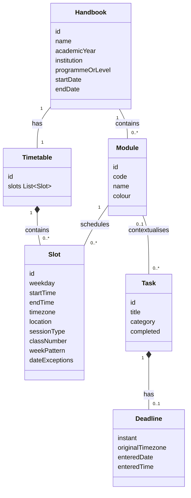

# Academic structure and tasks

One timetable spans the selected handbook (one semester). Each slot references a module in that semester. Dated occurrences use academic-calendar rules, whose detailed class model remains open. Foreign-key fields are omitted from this domain view.

