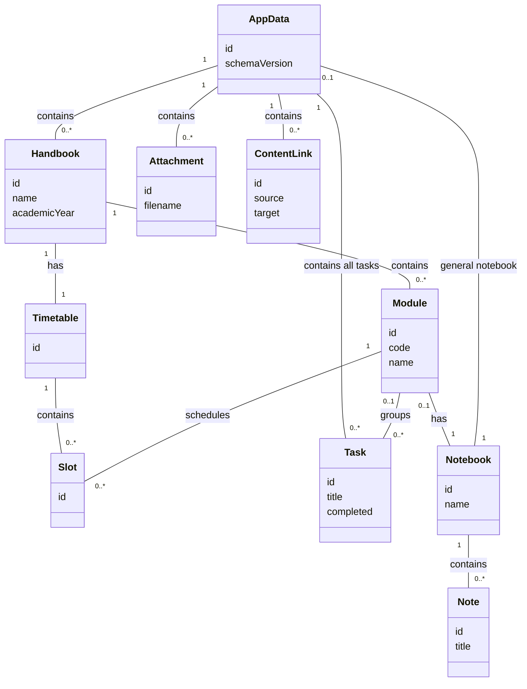

# AppData overview

`AppData` represents the complete collection across handbooks. A record's `appDataId` refers to `AppData.id`; the Google account association and sync/reset metadata are separate concerns.

- The module notebook and the AppData general notebook are distinct roles of `Notebook`. Each notebook belongs to exactly one module or is the collection's single general notebook.
- Module tasks/notes follow their module's handbook. Tasks without a module appear in the general inbox; the general notebook is outside handbook filtering. Switching handbooks changes the view, preserving older content.
- AppData contains every record in the collection, including records shown beneath a handbook here. Association lines show useful grouping; they do not duplicate those records or require nested JSON. The ID-based storage representation remains unchanged.
- Attachments may be referenced from multiple records through `ContentLink`. Its `source` and `target` are typed references (`{ type, id }`) to modules, tasks, notes or attachments. Fixed ownership fields such as `moduleId` remain direct references.
- Folder nesting, note bodies, deadlines and attachment versions are detailed in the other diagrams. Selecting a handbook is a preference; this diagram does not select its storage or sync scope. Future study/GPA/application features and sync infrastructure are omitted.

The [AppData storage schema](../schemas/app-data.schema.json) groups all current records in flat typed collections with ID references. This is a conceptual overview, not a requirement to load or upload all AppData on each edit. Note bodies, attachment bytes and sync/recovery history are separate.
