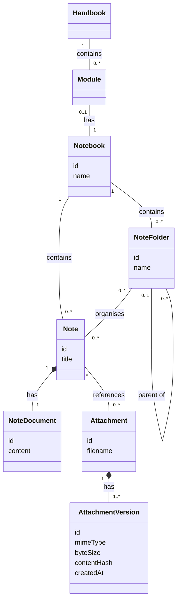

# Notes and attachments

Module notebooks and their notes belong to the module's handbook; selecting another handbook changes which module notes are shown. Older notes remain stored for a future all-notes view. The general notebook has no module and remains outside handbook filtering. Root notes/folders and nested folders are supported; all parent relationships stay within one notebook and folder cycles are invalid. Files can also link to modules/tasks. Document content is conceptual; storage currently uses a separate content reference pending editor selection.

