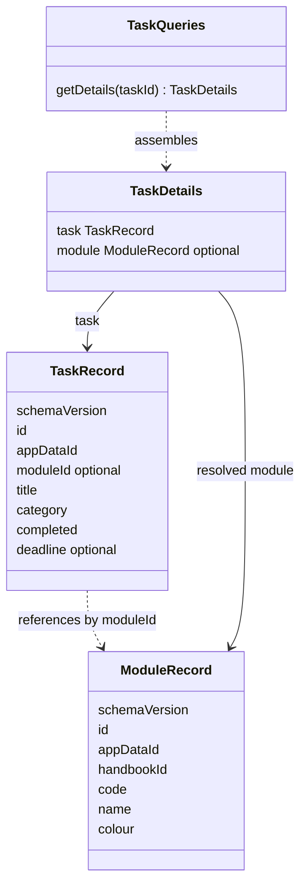

# Records and shared queries

Records store IDs; shared queries assemble related records for components. `TaskDetails` is a derived read model, not a stored/synced entity or an automatically persisted object graph. Query refresh/subscription APIs remain open. See the schemas for complete current storage fields.

